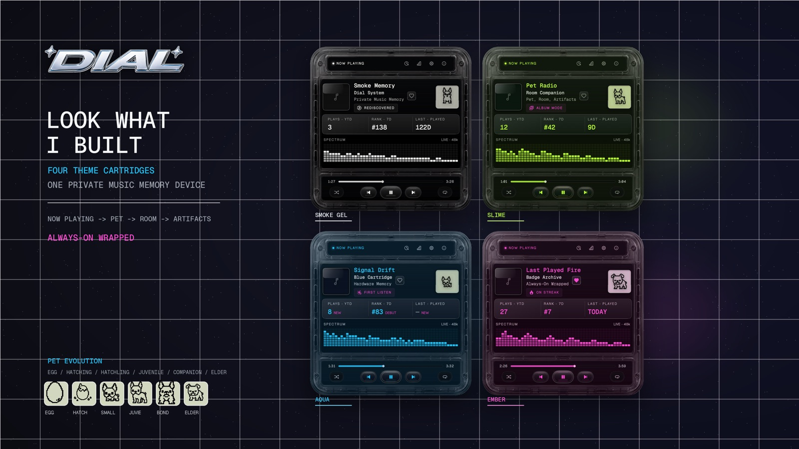
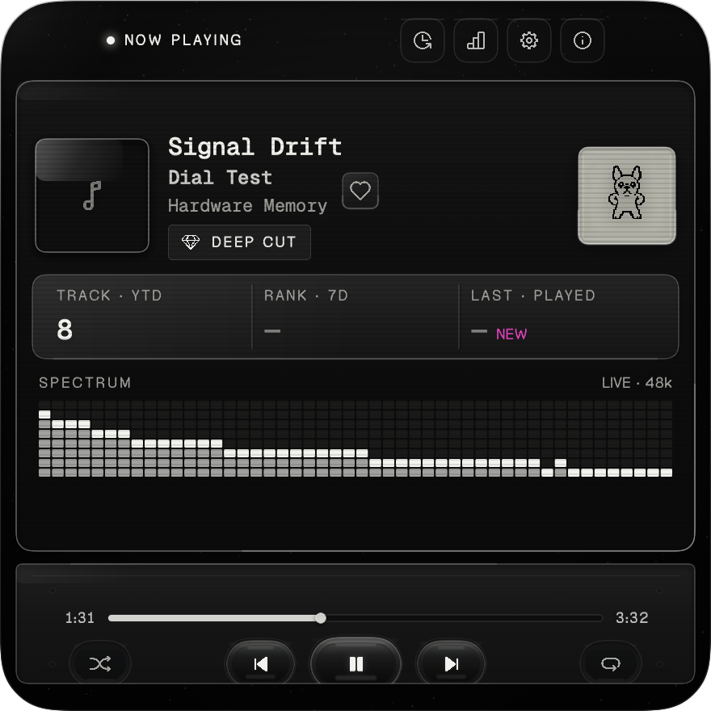
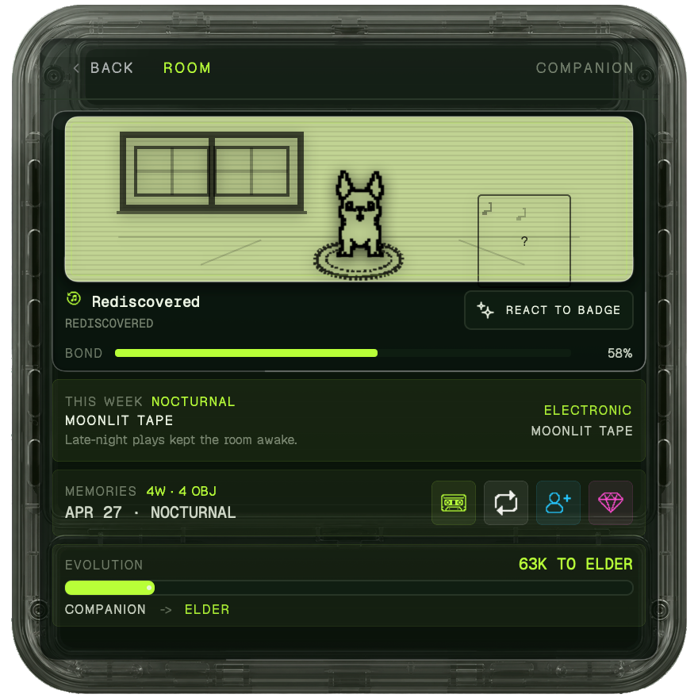
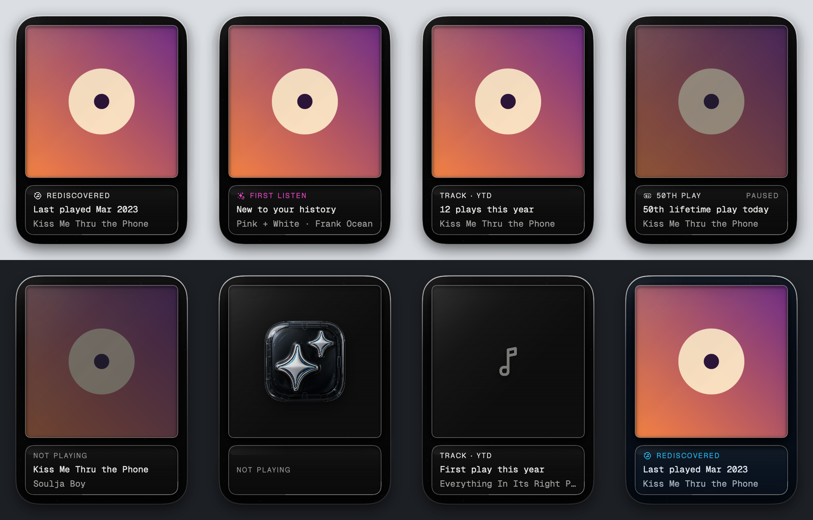

# Dial



**Now playing, remembered.** Dial is a native macOS menu bar companion for Spotify. It tells you what the song that's playing means to *you*: a first listen, a rediscovery after three years, your 50th play, its rank this week. It keeps a local archive of every play and raises a pixel pet that grows from an egg as you listen.

It's a personal project, built in SwiftUI and AppKit and designed like a piece of Y2K hardware: a smoked-plastic handheld with an LCD, not another streaming widget.

| The HUD | The pet's room |
|---|---|
|  |  |



*These are Dial's own visual-regression baselines: real renders of the app with made-up data.*

## What it does

- **Menu bar strip:** the current track and the pet, at Raycast density.
- **The HUD:** a 440×440 smoked-plastic device with the track, why it matters, plays this year, rank this week, last played, a live spectrum and transport. Pet, Stats and History screens open from its top rail.
- **Memories:** first listen, new artist, rediscovered, deep cut, 10th/50th/100th play and listening anniversaries, worked out from your own history. A small LCD pops up under the menu bar when a new track brings one back.
- **Desktop memory:** the current album and its memory as an object on your desktop, under your windows ([spec](docs/design/desktop-memory.md)).
- **Pet, room and artifacts:** a bulldog that hatches, grows through six stages and learns tricks, all driven by real listening. Badges unlock permanent objects for its room.
- **Theme cartridges:** Smoke Gel, Slime, Aqua and Magenta. The HUD can follow the genre of what's playing.
- **Last.fm:** scrobbling and Loved-track sync, with a queue that never double-sends.
- **Your whole history:** import Spotify's Extended Streaming History so stats start from day one, then read the archive from other apps through a small read-only CLI and API ([`integrations/dial_history`](integrations/dial_history/README.md)).
- **Mac details:** global ⌃⌥⌘ shortcuts with an LCD confirmation, launch at login, a permissions status panel, Focus filter support, VoiceOver labels and Reduce Motion.

## How it's built

- **SwiftUI + AppKit**, macOS 14+. The Xcode project is generated from [`project.yml`](project.yml) with XcodeGen.
- **Playback:** reads the Spotify app over Apple Events first and the Web API second (PKCE OAuth, Keychain tokens, a shared rate-limit gate). The Spotify app's playback notifications trigger an immediate read between polls.
- **Archive:** a local SQLite database through GRDB, with append-only migrations (v1…v18). A play counts through four layers of rules, and stats read a `counted_plays` view so imported skips can't inflate them.
- **Spectrum:** system audio through ScreenCaptureKit and an FFT, captured only while something plays.
- **Tests:** about 380 XCTest cases, including deterministic snapshot tests that pin dates and animation frames.
- **Design docs:** product intent in [`PRODUCT.md`](PRODUCT.md), the visual system in [`DESIGN.md`](DESIGN.md), the locked HUD geometry in [`HUD_LOOK_LOCK.md`](HUD_LOOK_LOCK.md), and notes for coding agents in [`AGENTS.md`](AGENTS.md).

## Build it yourself

You need macOS 14 or later, Xcode, and [XcodeGen](https://github.com/yonaskolb/XcodeGen) (`brew install xcodegen`).

1. **Signing:** run `./scripts/create-cert.sh` once. It creates a self-signed "Dial Local Dev" certificate in your login keychain, so macOS keeps Dial's Screen Recording permission across rebuilds.
2. **Spotify:** register an app at <https://developer.spotify.com/dashboard> and add `dial://callback` as a redirect URI. Copy `Config/Dial.local.xcconfig.example` to `Config/Dial.local.xcconfig` (gitignored) and set `SPOTIFY_CLIENT_ID` to your app's Client ID. No Client Secret is needed (PKCE).
3. **Build and run:**

```bash
./scripts/dev.sh build     # generate the Xcode project and build
./scripts/dev.sh install   # build, copy to /Applications/Dial.app and launch
```

## Tests

```bash
./scripts/dev.sh test       # the full suite
./scripts/dev.sh snapshot   # visual regression tests only
```

Snapshot baselines live in [`DialTests/Snapshots/VisualRegression/`](DialTests/Snapshots/VisualRegression/). Re-record them with `./scripts/dev.sh record` only after looking at every changed image. The manual checklist is [`docs/qa-checklist.md`](docs/qa-checklist.md).

## License

MIT; see [`LICENSE`](LICENSE). Fonts, icons and packages are credited in [`THIRD_PARTY_NOTICES.md`](THIRD_PARTY_NOTICES.md). Dial isn't affiliated with Spotify or Last.fm.
